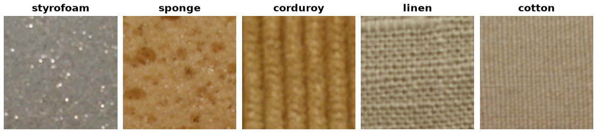

KTH-TIPS
========

Overview
--------

KTH-TIPS contains 810 color images of 10 materials photographed under
different scales, poses, and lighting conditions. Each material has 81
images. The cropped color images are 200 × 200 pixels.

The source dataset does not provide an official train/test split. The
``train`` split in this builder contains all 810 images.

Data Structure
--------------

Each ``ds[i]`` returns:

.. list-table::
   :header-rows: 1

   * - Key
     - Type
     - Description
   * - ``image``
     - ``PIL.Image.Image``
     - 200 × 200 RGB image
   * - ``label``
     - ``int``
     - Material class ID from 0 to 9
   * - ``scale``
     - ``int``
     - Scale identifier from 1 to 9
   * - ``image_id``
     - ``int``
     - Image identifier from 1 to 9 within that scale

Usage Example
-------------

.. code-block:: python

    from stable_datasets.images import KTHTIPS

    ds = KTHTIPS(split="train")
    print(len(ds))  # 810

    sample = ds[0]
    print(sample["image"].size, sample["label"], sample["scale"])

Source and Citation
-------------------

- Source: https://www.csc.kth.se/cvap/databases/kth-tips/
- M. Fritz, E. Hayman, B. Caputo, and J.-O. Eklundh,
  *The KTH-TIPS Database*, 2004.